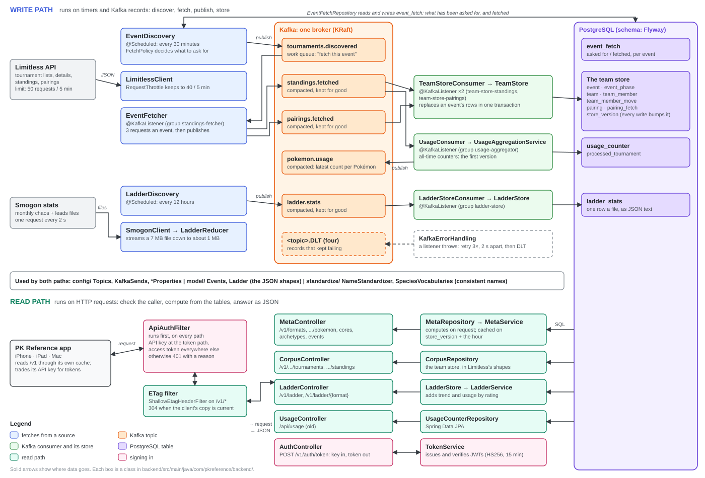

# PK Reference backend (Kafka + Spring Boot)

Companion service for the PK Reference app. It pulls Limitless tournament data, streams it
through Kafka, keeps every event's teams and matches in Postgres, and serves insights and Team
Search's corpus at `/v1`. It also fetches Smogon's monthly ladder stats and serves them reduced
([the ladder](#the-ladder)). The app reads the corpus from it when Settings → PK Reference Server
(Beta) is on ([below](#using-it-from-the-app)).
[`BackendIntegration-PLAN.md`](../BackendIntegration-PLAN.md) is where it's going, and has the
metrics' definitions (§4.2).

```
Limitless --poll--> EventDiscovery    --> tournaments.discovered
                    EventFetcher      --> standings.fetched + pairings.fetched (details, standings, matches)
                    TeamStoreConsumer --> Postgres: event, event_phase, team, team_member(_move), pairing
                    UsageConsumer     --> Postgres counters + pokemon.usage (compacted)
                    MetaController    --> GET /v1/formats/... (insights from the team store)
                    CorpusController  --> GET /v1/.../tournaments, standings (Team Search's corpus)
                    UsageController   --> GET /api/usage?format=... (the first version's all-time counts)
Smogon --poll-->    LadderDiscovery   --> ladder.stats (each monthly file, reduced)
                    LadderStoreConsumer --> Postgres: ladder_stats
                    LadderController  --> GET /v1/ladder, /v1/ladder/{format}
```



**New to the code?** [`docs/PKReference-backend-guide.pdf`](docs/PKReference-backend-guide.pdf) is a study
guide: how the data flows, the Spring and Kafka ideas the project uses and where, every table and
endpoint, and every class and method, taken from the comments in the source.

## Run
```sh
cd backend
docker compose up -d                 # Kafka on :9092, Kafka UI on :8081, Postgres on :5432, all on 127.0.0.1
mvn spring-boot:run                  # API on 127.0.0.1:8080, Swagger UI at /swagger-ui.html
curl 'localhost:8080/v1/formats'
```
Set `LIMITLESS_GAME` and `LIMITLESS_FORMATS` (comma-separated, such as `M-C,M-B`; empty for every format)
to pick the circuit (see `GET /games` on the Limitless API). `LIMITLESS_FORMAT`, the old single format,
still works.
`DATABASE_URL`, `DATABASE_USER` and `DATABASE_PASSWORD` point it at another Postgres, and
`KAFKA_BOOTSTRAP_SERVERS` at another broker.

Kafka and Postgres keep their data in Docker volumes (`pkref-kafka`, `pkref-postgres`), so it survives
restarts and `docker compose down`; `docker compose down -v` deletes it. Flyway creates and upgrades the
tables (`src/main/resources/db/migration`).

### Upgrading from the H2 version
The counters used to be in an H2 file under `backend/data/`. They move to Postgres and start empty, so
delete `backend/data/`. The first `docker compose up -d` after this change recreates the Kafka container
with its volume; the topics it held inside the container are lost, as on any recreate before.

### API v1
Read-only and the same for everyone. Responses may be reused for 15 minutes (`Cache-Control`), carry a
weak ETag (a matching `If-None-Match` gets a 304), and are gzipped. Each says what it covers: the window,
when it was worked out, and how many events, teams and top-cut teams it rests on.
```sh
curl 'localhost:8080/v1/formats'
curl 'localhost:8080/v1/formats/M-C/pokemon?window=30d'                # 14d, 30d or regulation
curl 'localhost:8080/v1/formats/M-C/pokemon/arcanine:hisui?window=30d'
curl 'localhost:8080/v1/formats/M-C/cores?window=30d'
curl 'localhost:8080/v1/formats/M-C/archetypes?window=30d'
curl 'localhost:8080/v1/formats/M-C/archetypes/garchomp+gholdengo+incineroar+rillaboom?window=30d'
curl 'localhost:8080/v1/formats/M-C/events?limit=10'
```
**Full reference:** with the backend running, Swagger UI at
[localhost:8080/swagger-ui.html](http://localhost:8080/swagger-ui.html) describes every endpoint, parameter
and field, and lets you try them; the OpenAPI document is at `/v3/api-docs`. Both come from the
annotations in `MetaController` and `MetaResponses`.
- The list: each Pokémon's `usage` (share of teams), `topCutUsage` (share of top-cut teams, null when the
  window had no top cut), `trend` (usage in the last 14 days less the 14 before; null when either
  period has under 50 teams) and `record`: wins, losses and ties from the pairings, leaving out mirror
  matches, with a win rate (a tie is half a win) and its 95% range, null under 30 matches.
- A Pokémon's page: its items, abilities, natures, moves, Mega Stones and teammates, its 10 most common
  whole sets, and its usage week by week.
- Cores: the 20 most common pairs and trios (on 4 teams or more), with `lift`, their share over what
  chance would give.
- Archetypes: teams grouped by a core of four (defined in the plan's §4.2), each with its usage, top-cut
  rate, record, and record against each other archetype. `name` is the core's two most-used members, with
  more of the core when an archetype with more teams already has that name, so it's unique, as `id` is.
  One archetype's page adds its five best-placed teams with their sets.
- Events: the newest stored events, with their size, whether their standings are final, how many played
  in their top cut, and the winner's record and team.

- The corpus, for the app's Team Search: the stored events in Limitless's own shapes, answering the two
  calls the app makes to Limitless, so a device can build its corpus from the server instead:
  ```sh
  curl 'localhost:8080/v1/formats/M-C/tournaments?page=1&limit=50'   # newest first, like GET /tournaments
  curl 'localhost:8080/v1/tournaments/<id>/standings'                 # like GET /tournaments/{id}/standings
  ```
  The standings come back as Limitless sent them, except its `deck` label, which isn't kept.

`MetaService` works these out from the team store when asked, and keeps each result until the store
changes (`store_version`, which every write bumps in its transaction) or the hour does. Shares are 0 to 1.
Definitions are in [the plan](../BackendIntegration-PLAN.md) (§4.2).

The older `GET /api/usage?format=…` and `/api/usage/{species}` still serve the first version's all-time
counts. Nothing calls them; the plan drops them by Phase 7.

### The ladder
Pokémon Showdown's ladder, from [Smogon's monthly usage stats](https://www.smogon.com/stats/), for
Champions doubles (best of 1 and best of 3) and singles (Battle Stadium Singles), at each of Smogon's
rating cutoffs: 0 (every player), 1500, 1630 and 1760.
[`BackendIntegration-PHASE5.md`](../BackendIntegration-PHASE5.md) has the design.
```sh
curl 'localhost:8080/v1/ladder'                                              # what's stored
curl 'localhost:8080/v1/ladder/gen9championsvgc2026regmc?rating=1760'        # the newest month
curl 'localhost:8080/v1/ladder/gen9championsbssregmc?rating=1500&month=2026-09'
```
- `/v1/ladder` lists each stored format, month and rating, with its regulation ("M-C"), `mode` (doubles
  or singles), `bestOf` and how many battles it's from. The format ids are Smogon's; the doubles one has
  the year in it, so take them from this list rather than building them.
- `/v1/ladder/{format}` is one month at one rating (1760 and the newest month unless asked): every
  Pokémon used, most used first, with its `usage` (share of teams with it on the team of six, weighted
  for the rating as Smogon does), `leadShare` (its share of all leads), and its abilities, items, moves,
  natures, `spreads` (nature and stat points, "Adamant:2/32/0/0/0/32") and teammates, each as a share
  of the Pokémon's own teams. `trend` is its usage less the month before's, and `usageByRating` its
  usage at each stored rating; both come from the other stored files.
- A Pokémon holding its Mega Stone is its own entry, as Smogon counts it: `name` is Smogon's
  ("Salamence-Mega") and is what's unique; `key` is the app's species key and `megaStone` the stone.

Every 12 hours `LadderDiscovery` looks at Smogon's newest months (`SMOGON_LOOKBACK_MONTHS`, 2) and
fetches each Champions doubles and singles file not stored yet: the `chaos/` JSON and its `leads/`
table. A month's files appear on the 1st of the next month and never change, so each is fetched once:
about 24 files and 50 MB a month, one request at a time, 2 seconds apart. `LadderReducer` cuts each file
(up to 7 MB) down to what the app shows (about 1 MB at most, 0.15 MB gzipped), and that is what `ladder.stats` and the
`ladder_stats` table keep; Smogon keeps the files themselves. To go further back, start once with
`SMOGON_LOOKBACK_MONTHS=6`. `SMOGON_INGEST_ENABLED=false` turns the fetching off.

`LadderReducer`'s rule is written down in the Phase 5 file (§3), because the app is to make the same
record from the same files when it has no server; `golden/ladder-fixture.json` is what both sides are
checked against. A change to the rule needs a new `LadderReducer.REDUCTION`, which makes the server fetch
what it holds again, and the same change in the app.

### Using it from the app
Settings → PK Reference Server (Beta) in the app, off by default, takes the server's address,
`http://localhost:8080` by default: that reaches this machine from the simulator and the Mac app. A phone
uses the Tailscale address (below). Test Connection lists the formats
`/v1/formats` reports. With the switch on, Team Search and the Problem Solver read their corpus from
`/v1/.../tournaments` and `/standings`, and from Limitless whenever the server can't answer
(`PKReference/MetaServer.swift`).

### Signing in to the API
With no API keys configured, the API answers anyone who can reach it. With one or more
(`PKREF_API_KEY_HASHES`), a client signs in in two steps:

1. **Trade the key for an access token.** `POST /v1/auth/token` with `Authorization: Bearer <key>`
   answers `{"token": "…", "tokenType": "Bearer", "expiresIn": 900, "expiresAt": "…"}`.
2. **Send the token with everything else:** `Authorization: Bearer <token>`. After 15 minutes
   (`PKREF_TOKEN_LIFETIME`) the server answers 401 with `"code": "token_expired"`, and the client
   trades the key again.

```sh
KEY=pkr_…                             # from scripts/new-api-key.sh
TOKEN=$(curl -s -X POST -H "Authorization: Bearer $KEY" localhost:8080/v1/auth/token | jq -r .token)
curl -H "Authorization: Bearer $TOKEN" 'localhost:8080/v1/formats'
```

So the long-lived key crosses the network once every few minutes rather than with every request, and a
token that leaks stops working by itself. The data endpoints don't take the key at all.

- **The token is a JWT** (`TokenService`): a header, claims and a signature. The claims say who made it
  (`iss`), what for (`aud`), which key it was traded for (`sub`, the first 8 digits of the key's hash)
  and when it runs out (`exp`). They're only base64, readable by anyone, so nothing secret is in them;
  the signature (HMAC-SHA256, with a secret only the server has) is what stops anyone changing them.
- **The server refuses** a token that's run out, changed, signed with another secret or another
  algorithm (including "none"), made for something else, or traded for a key whose hash has since
  been removed: removing a hash retires its key and its tokens together.
- **The signing secret** is random each time the server starts, unless `PKREF_TOKEN_SECRET` (32
  characters or more; `openssl rand -base64 48`) is set. A restart then ends the tokens from before
  it, and clients trade their keys again, which the app does without being asked.
- **A 401 says why** in `code`: `missing_credentials`, `invalid_key`, `invalid_token` or
  `token_expired`. Neither credential is read from a URL or logged, answers say
  `Cache-Control: private`, and the token answer says `no-store`.
- **Swagger UI** still opens. Authorize with the key (`apiKey`), run `POST /v1/auth/token`, then
  Authorize with the token it returns (`accessToken`).

### Reaching it from your phone
Everything listens on this machine only (`127.0.0.1`): Kafka UI has no login, Kafka and Postgres take
anyone who reaches them, and the API answers anyone. A phone reaches the API, and nothing else, through
[Tailscale](https://tailscale.com): a private network of your own devices, with HTTPS, nothing opened on
the router, and nothing on the public internet. An API key is the second lock.

1. **The key.** Run `scripts/new-api-key.sh`. It prints a key, for the app, and its hash, for the
   server. Put the hash in `backend/.env` (git ignores it), then start the server with it:
   ```sh
   echo 'PKREF_API_KEY_HASHES=<hash>' >> .env
   set -a; . ./.env; set +a; mvn spring-boot:run
   ```
   With a hash set, clients sign in with the key ([above](#signing-in-to-the-api)). Several keys are
   comma-separated hashes; remove a hash to retire its key. Keep the key out of the repository, chats
   and screenshots: the server only ever has its hash.
2. **Tailscale.** Install it on this Mac and the phone, signed in to the same account, then give the
   API an HTTPS address on your tailnet:
   ```sh
   tailscale serve --bg 8080
   ```
   It prints the address, such as `https://your-mac.your-tailnet.ts.net`. Only your devices can reach
   it. Don't use `tailscale funnel`, which puts it on the public internet.
3. **The app.** Settings → PK Reference Server (Beta): that address, and the key under API Key, which
   the app keeps in the Keychain. It trades the key for tokens by itself, and sends either only over
   HTTPS (or to this machine). Test Connection says if the key is wrong.

Without Tailscale, `SERVER_ADDRESS=0.0.0.0` opens the API to every network this machine is on, over
plain HTTP, where the key can be read: keep it to a network you trust. The ports `docker compose`
publishes change to `127.0.0.1` when it next recreates the containers (`docker compose up -d`); their
data stays in the volumes. Postgres keeps the password it was created with (`pkref`), which only
matters to something that can reach it.

### Running it on a server (Oracle Cloud)
The same stack runs on one small Linux machine: Oracle Cloud's Always Free Arm VM fits it, and its Arm
processor is the same architecture as an Apple-silicon Mac. `docker-compose.server.yml` adds the API
itself (built on the machine from this repository by `Dockerfile`), memory limits, restarts and a real
Postgres password, and keeps Kafka UI off unless asked for. Everything is still published on `127.0.0.1`
only; the phone and the Mac reach the API through Tailscale, as above.

Measured on the Arm image: the API uses about 400 MB, Kafka 550 MB and Postgres 100 MB.

1. **The VM.** In the Oracle console, Compute → Instances → Create instance:
   - image: Canonical Ubuntu 24.04 (aarch64);
   - shape: Ampere `VM.Standard.A1.Flex`, **1 OCPU and 4 GB**. Oracle reclaims an Always Free
     instance that's idle for 7 days (95th-percentile CPU, network and memory all under 20%); the
     stack's roughly 1.5 GB with the system is over 20% of 4 GB, and the limits above still fit;
   - SSH key: paste your public key (`~/.ssh/id_ed25519.pub`); keep the public IPv4 address, for the
     first login and for the machine's own downloads.
2. **First login, and the software:**
   ```sh
   ssh ubuntu@<public-ip>
   sudo apt update && sudo apt -y upgrade
   sudo apt -y install docker.io docker-compose-v2 git
   sudo usermod -aG docker ubuntu          # then log out and in again
   curl -fsSL https://tailscale.com/install.sh | sh
   sudo tailscale up --ssh                 # sign in with the account your phone and Mac use
   ```
   From then on, `ssh ubuntu@<machine name>` reaches it over Tailscale. **Delete the SSH (port 22)
   ingress rule** from the instance's subnet security list in the Oracle console: the machine then
   takes nothing from the internet.
3. **The code, and its settings.** On the server:
   ```sh
   git clone -b backend-integration https://github.com/rra013/PKReference.git
   cd PKReference/backend
   umask 077 && cat > .env <<EOF
   POSTGRES_PASSWORD=$(openssl rand -hex 24)
   PKREF_API_KEY_HASHES=<the hash from scripts/new-api-key.sh, run on your Mac>
   LIMITLESS_FORMATS=M-C
   LIMITLESS_LOOKBACK=120d
   EOF
   ```
   Make the key on your Mac (`scripts/new-api-key.sh`) and bring only its hash to the server.
   `LIMITLESS_LOOKBACK=120d` backfills on the first start (hours, under Limitless's limit); set it back
   to `7d` afterwards.
4. **Start it, and give it an address:**
   ```sh
   docker compose -f docker-compose.yml -f docker-compose.server.yml up -d --build
   sudo tailscale serve --bg 8080
   ```
   The first build takes about 10 minutes. The first `tailscale serve` asks you to turn on HTTPS for
   your tailnet (a link to its admin page). It then prints the HTTPS address
   (`https://<machine name>.<tailnet>.ts.net`) for the app's Settings, with the key.
5. **Backups.** `crontab -e`, and add
   `0 4 * * * /home/ubuntu/PKReference/backend/scripts/backup.sh`. It keeps 14 days of Postgres dumps
   in `~/pkref-backups`. Copy them off the machine now and then, from the Mac:
   `scp '<machine name>:pkref-backups/*' ~/pkref-backups/`.

**Updating:** `git pull`, then the `docker compose … up -d --build` line again. **Logs:**
`docker logs -f pkref-api`. **Kafka UI:** `docker compose -f docker-compose.yml -f
docker-compose.server.yml --profile ui up -d kafka-ui`, then `ssh -L 8081:127.0.0.1:8081 <machine name>`
and open `localhost:8081` on the Mac. Once the server runs there, stop the one on the Mac, so Limitless
sees one crawler.

### Finding events, and backfilling
Every 30 minutes `EventDiscovery` walks each format's tournament list back through the lookback
(`LIMITLESS_LOOKBACK`, 7 days) and asks for the events to fetch, by the app's rules
(`TeamCorpusConfiguration`): 16 players or more, and started. Standings are final 48 hours after an
event starts; until then it's fetched again every 6 hours. `event_fetch` records what's been asked for,
so an event waiting in the queue isn't asked for twice.

To backfill, start it once with a longer lookback, then go back to the default:
```sh
LIMITLESS_FORMATS=M-C,M-B LIMITLESS_LOOKBACK=120d mvn spring-boot:run
```
Each event takes three requests (details, standings, pairings), so under the throttle a backfill fetches
about 13 events every 5 minutes, and several hundred take hours. It picks up where it was after a
restart.

### The team store
`TeamStoreConsumer` writes every fetched event into Postgres: `event` and its `event_phase`s (Swiss, top
cut), each player's `team` (placement, record) with its `team_member`s and their moves, and every match in
`pairing` with its `result` (`P1`, `P2`, `TIE`, `DOUBLE_LOSS`, `BYE`, `NO_SHOW`). Each member also gets
its `species_key` the app's way ("arcanine:hisui": the species and the form words its regulation lists)
and its `mega_stone` when it holds one of its own Mega Stones (`SpeciesVocabularies`, a port of the app's
`TeamSearchVocabulary`, built from the same bundled files). Rows stored before that came in get keys
when the store is rebuilt (below). A newer fetch of an event
replaces its rows, and an older one is ignored. The top cut is who played in a bracket phase (`phase > 1`).
Events are stored before their standings are final (`standings_final`), so they can be seen early; the
usage counters wait until they are.

### Rebuilding the counters and the store
`standings.fetched` and `pairings.fetched` keep every event fetched, and `ladder.stats` every reduced
month of the ladder, so anything built from them can be
rebuilt, after a fix to `NameStandardizer` for example. With the backend stopped:
```sh
# The usage counters
docker compose exec postgres psql -U pkref -c 'truncate usage_counter, processed_tournament'
docker compose exec kafka /opt/kafka/bin/kafka-consumer-groups.sh --bootstrap-server kafka:19092 \
  --group usage-aggregator --reset-offsets --to-earliest --all-topics --execute
# The team store and the ladder (each record replaces the one stored, so no truncate is needed)
for g in team-store-standings team-store-pairings ladder-store; do
  docker compose exec kafka /opt/kafka/bin/kafka-consumer-groups.sh --bootstrap-server kafka:19092 \
    --group $g --reset-offsets --to-earliest --all-topics --execute
done
```

## Test
`mvn verify` runs the unit tests and the embedded-Kafka pipeline tests, on an in-memory database (H2) with
the same migrations. The store's tests also run on Postgres 17 in Docker (Testcontainers), because H2 lets
through SQL Postgres rejects; without Docker they're skipped. The fixtures in
`src/test/resources/limitless/` are one real event's API responses, with the players' names replaced.
`golden/species-identity.json` holds species keys recorded from the app: the app's
`SpeciesIdentityGoldenTests` and the backend's `SpeciesVocabularyGoldenTest` both check against it, so a
change to either side's naming fails a test until the other matches. `golden/meta-fixture.json` holds the
insights `MetaService` works out from the fixture event (usage, trends, sets, cores, archetypes), checked
by `MetaGoldenFileTest`, for the app's version worked out on the device to match. After a deliberate
change to the insights, record it again with `mvn test -Dtest=MetaGoldenFileTest -Dgolden.record=true`.
`src/test/resources/smogon/` holds Smogon's real 2026-09 files for M-C doubles at 1760, cut down to 27
Pokémon; `golden/ladder-fixture.json` is that fixture reduced, checked by `LadderGoldenFileTest` and by the
app's reducer (record it again the same way). Tests never call Limitless or Smogon: every test that
starts the application reads `src/test/resources/config/application.yml`, which turns the Smogon poll off.
GitHub Actions runs it for changes to the backend (`.github/workflows/backend.yml`).

## Name standardization
Players type items, abilities and moves by hand, so `NameStandardizer` canonicalizes them before counting
("MIRACLE SEED" / "Fake-out" / "Darkest Larient" -> "Miracle Seed" / "Fake Out" / "Darkest Lariat").
It reads the repo-root `champions-*.json` regulation files, their learnsets,
`PKReference/showdown-champions-data.json` (bundled onto the classpath at build time) and
`reference/champions-items.json`, a snapshot of Serebii's Champions item page (every Champions item, not
per regulation). It fixes spelling and casing and never drops a value, since decklists also come from formats
with no regulation file (fan formats, older or newer regulations); names matching nothing are kept, title-cased.
After changing it, rebuild the counters (above) so they use the new spellings.

## Notes
- Limitless allows 50 requests in 5 minutes without a key. `LimitlessClient` keeps to 40
  (`pkref.limitless.requests-per-window` and `window`), leaving room for the app on the same machine, and
  waits whenever Limitless's `ratelimit` header says none are left.
- `standings.fetched` is compacted to the latest standings per tournament and never deleted. Its records
  can be up to 5 MB, and the producer compresses them (zstd): standings are about 1.2 KB of JSON a player,
  over the broker's default 1 MB limit at about 850 players. Starting the backend applies these settings to
  topics that already exist.
- `pairings.fetched` is kept the same way.
- Every send is waited for, so a failed one throws: the event's fetch retries and then goes to the DLT,
  instead of being dropped.
- Aggregation is idempotent per tournament id: replays and duplicate deliveries are no-ops.
- Failed records retry 3 times, then go to `<topic>.DLT`.
- The usage consumer is deliberately single-threaded (shared counters).
